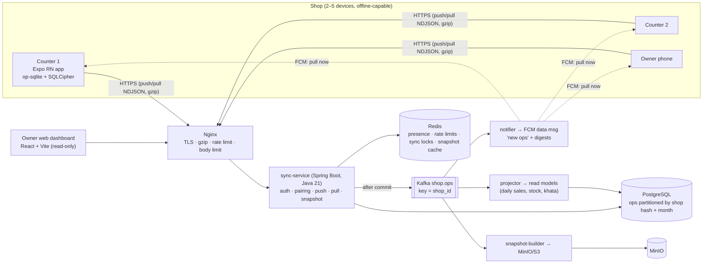
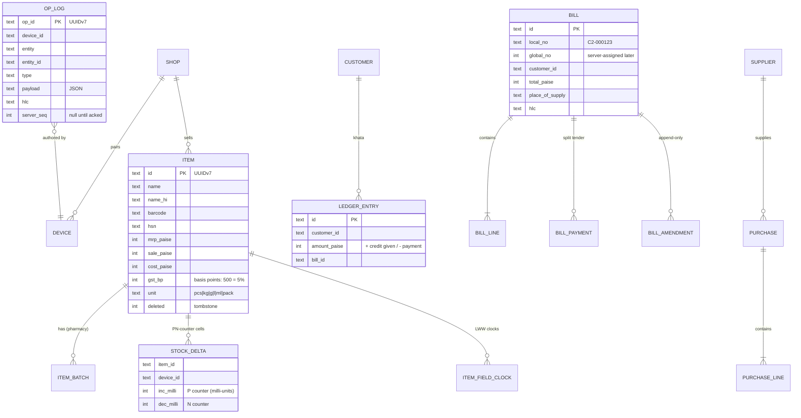
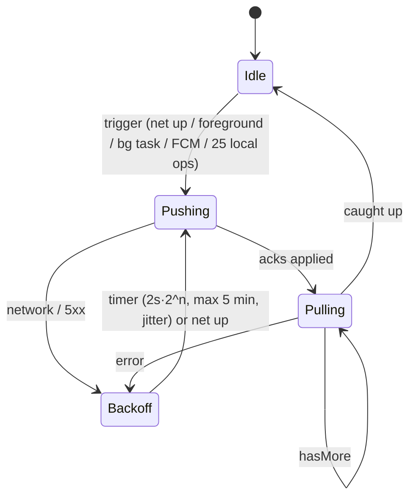

# Dukaan — Architecture

Offline-first GST billing, inventory and khata POS for Indian kirana / pharmacy / hardware shops.
2–5 devices per shop work fully offline and converge after reconnecting.

## 1. System overview



The device is the system of record for the shop's day-to-day work. The server is a durable, ordered
relay plus backup and reporting; billing never waits on it.

## 2. Monorepo layout

| Path | What |
|---|---|
| `apps/mobile` | Expo (dev client, prebuild) + Expo Router app |
| `apps/dashboard` | Owner web dashboard (React + Vite, read-only) |
| `packages/core` | Pure TypeScript domain: paise money, GST engine, units, HLC, op model, merge rules, transliteration, search query builder. No React, no native — runs in Node and Hermes |
| `packages/db` | Versioned SQL migrations, `SqlDriver` interface, repositories, sync engine apply/collect. Tested in Node against `better-sqlite3` (same SQLite dialect + FTS5) |
| `packages/native` | One Nitro module package (`@dukaan/native`) with two hybrid objects: `BluetoothPrinter` (Android classic SPP RFCOMM, iOS BLE write characteristic; chunked writes on a single IO thread) and `HidScanner` (Android `Window.Callback` wrapper that holds fast key bursts and replays them if they turn out to be typing; iOS no-op, the search box Enter path covers it). One package = one nitrogen run, one autolinking entry, one `.so` |
| `services/sync` | Spring Boot sync-service + workers (one codebase, roles by Spring profile) |
| `tools/seeder` | Realistic shop generator (100k SKUs, 50k bills, 500 customers) |
| `infra/` | docker compose, nginx, prometheus/grafana, k6 |

The rule that makes this testable: **every piece of business logic that the sync engine depends on
lives in `packages/core` + `packages/db` and is driver-agnostic**, so the 3-device partition
simulation runs real migrations and real SQL in Node.

## 3. Device data model



Conventions:
- Money is `INTEGER` paise. Quantity is `INTEGER` milli-units (1 kg = 1000, 1 pc = 1000), so loose
  weights never touch floats. Tax rates are basis points.
- Stock on hand is never stored as one mutable number: `SUM(inc_milli - dec_milli)` across
  `stock_delta` rows (one row per item × device), cached in `item_stock` and refreshed in the same
  transaction.
- Khata balance = `SUM(amount_paise)` over `ledger_entry`.
- `item_search` is an FTS5 table (see §6), kept in sync by triggers.

## 4. Operation log and HLC

Every local write is a function `(state, command) → ops[]`. The repository applies the ops to local
tables **and** inserts them into `op_log` inside one SQLite transaction. There is no write path that
skips the log.

```ts
type Op = {
  opId: string;        // UUIDv7 — idempotency key end to end
  deviceId: string; shopId: string;
  entity: 'item' | 'stock' | 'bill' | 'payment' | 'ledger' | 'customer' | 'supplier' | 'purchase' | 'tombstone' | 'ack';
  entityId: string;
  type: string;        // 'item.upsert', 'stock.delta', 'bill.create', 'bill.amend', ...
  payload: unknown;
  hlc: string;         // "<physical ms, 15 digits>:<counter, 5 digits>:<deviceId>" — sorts lexicographically
};
```

**Hybrid Logical Clock** (Kulkarni et al.): `send/local` → `l = max(l, now)`, counter bumps when `l`
does not advance; `receive(remote)` → `l = max(l, remote.l, now)` with counter merge. The device id
suffix makes HLCs totally ordered. A remote HLC more than 24 h ahead of local wall time is rejected
(protects against one broken clock poisoning every LWW decision); the op is quarantined and shown on
the diagnostics screen.

## 5. Conflict resolution rules

| Entity | Rule | Why |
|---|---|---|
| Bill, bill line, payment | Immutable, append-only. Edits are `bill.amend` ops referencing the original; the effective bill is original + amendments in HLC order. Void = amendment with `status=void` | A sale that happened can't be "overwritten" — GST and audit both need the history |
| Stock quantity | **PN-Counter CRDT**: per (item, device) `inc`/`dec` grow-only cells; merge = per-cell max; value = Σinc − Σdec | Two counters selling the last packet offline both succeed. Stock may go negative → reconcile alert, never a lost sale |
| Item master fields | **Per-field LWW register** keyed by HLC. Tie on identical physical time + counter → op from `owner` role wins, then larger device id | Owner changes price while cashier fixes name offline → both survive |
| Khata | Derived from immutable `ledger_entry` ops; balance is never a stored mutable value | No lost payments, no double counting |
| Customer / supplier master | Per-field LWW, same as items | |
| Deletes | Tombstone op (`deleted=1`, field-level LWW so a later edit can't resurrect it unless it's an explicit `restore`). Server GCs tombstones once every active device's `ack_seq` ≥ tombstone seq | Late-arriving edits must not resurrect deleted rows |
| Bill numbering | Device-local series `<prefix>-<seq>` (e.g. `C2-000123`) allocated in the bill transaction. Server assigns a gap-free `global_no` per shop per financial year on ingest and returns it via pull (`bill.number` op) | No collisions offline, compliant series online |

Apply is **commutative and idempotent** for every op type (CRDT merge or LWW compare, plus
`INSERT OR IGNORE` on `op_id`), so applying ops in any order or twice yields the same state. HLC
order is still used when applying pulled batches so amendments and audit views read naturally.

## 6. Search design (100k SKUs, < 50 ms p95)

- `item_search` = FTS5 `tokenize='trigram'` over `name || ' ' || name_hi || ' ' || translit || ' ' || barcode`,
  `content=''`-less external content on `item` (`content='item'`, `content_rowid='rowid'`).
- Query planner in `packages/core/search`:
  1. pure digits ≥ 6 → exact barcode lookup on index (`item.barcode`), < 1 ms.
  2. Devanagari input → transliterate to Latin key; Latin input → also generate Devanagari candidates
     from the local map (`chawal` ↔ `चावल`). Both are matched against the `translit` column, which
     stores a normalised Latin phonetic key (vowel-folded, `aa→a`, `w→v`, `sh→s` …) so spelling
     variants collide.
  3. Tokens ≥ 3 chars → FTS5 trigram `MATCH` (substring + typo-tolerant via trigram overlap);
     tokens < 3 chars → prefix range scan on `item.name_key` index (`>= 'ch' AND < 'ci'`).
  4. Rank = `bm25` blended with `sales_score` (exponentially decayed count of recent sales, kept in
     `item_rank`), LIMIT 30.
- Queries are debounced (80 ms), and each keystroke bumps a generation counter; stale results are
  dropped. op-sqlite runs `executeAsync` on its own thread so the JS thread never blocks.

## 7. Sync protocol

```mermaid
sequenceDiagram
  autonumber
  participant D as Device (sync engine)
  participant N as Nginx
  participant S as sync-service
  participant P as Postgres
  participant R as Redis
  participant K as Kafka shop.ops
  participant O as Other devices

  Note over D: trigger: reconnect · foreground · background task · FCM nudge · after N local ops
  D->>D: SELECT ops WHERE server_seq IS NULL ORDER BY hlc LIMIT 500
  D->>N: POST /v1/sync/push (gzip NDJSON, Idempotency by op_id)
  N->>S: forward (rate limit per device, 2 MB cap)
  S->>R: SET lock:shop:{id} NX PX 5000 (short critical section)
  S->>P: INSERT ops ... ON CONFLICT (op_id) DO NOTHING<br/>server_seq = shop sequence nextval
  S->>P: assign global bill numbers for new bill.create
  S-->>D: 200 {acks:[{opId, serverSeq}], maxSeq}
  S->>K: publish (key=shop_id) after commit (outbox)
  K-->>O: notifier → FCM data "ops-available(maxSeq)"
  D->>D: UPDATE op_log SET server_seq=? (acked)
  loop until hasMore=false
    D->>N: GET /v1/sync/pull?since=lastSeq&limit=1000
    S->>P: SELECT ops WHERE shop_id=? AND server_seq > ? ORDER BY server_seq
    S-->>D: NDJSON page + nextSeq
    D->>D: BEGIN; apply ops (sorted by HLC, idempotent); lastSeq=nextSeq; COMMIT
  end
  D->>N: POST /v1/sync/ack {seq}  (enables tombstone GC)
```

Properties:
- **Idempotent push**: `op_id` is the primary key server-side; re-sending a batch after a dropped
  response is a no-op that returns the same acks.
- **Resumable at any byte**: push batches are small (≤ 500 ops) and re-sendable; pull is
  cursor-based (`since=server_seq`), and the cursor is advanced in the same SQLite transaction as the
  applied page — a crash mid-page re-pulls that page and re-applies idempotently.
- **Per-shop ordering**: one Postgres sequence-like counter per shop (`shop.next_seq` row with
  `UPDATE … RETURNING`), and Kafka key = shop_id keeps downstream consumers in the same order.
- **Outbox**: ops are written to Postgres first; a relay publishes to Kafka from the `ops` table
  (cursor per shop) so Kafka can lag or be down without losing a single op.
- **Bootstrap**: a new device downloads `GET /v1/sync/snapshot` → gzip NDJSON of current state
  (built by snapshot-builder into MinIO, with its `server_seq` watermark), loads it in one transaction,
  then pulls incrementally from the watermark. Falls back to full op replay if no snapshot exists.

## 8. Device sync engine



Single-flight: one sync run at a time per device (mutex in JS). DB work goes through op-sqlite's
async executor, so billing stays responsive during a 10k-op catch-up.

## 9. Backend data model (Postgres)

```sql
ops(shop_id uuid, server_seq bigint, op_id uuid, device_id uuid, entity text, entity_id uuid,
    type text, hlc text, payload jsonb, received_at timestamptz,
    PRIMARY KEY (shop_id, server_seq)) PARTITION BY HASH (shop_id) -- 16 partitions,
    -- each sub-partitioned BY RANGE (received_at) monthly
op_ids(op_id uuid PRIMARY KEY, shop_id uuid, server_seq bigint)   -- global idempotency
shops, devices(role, ack_seq, last_seen), pairing_tokens, bill_numbers(shop_id, fy, next_no)
read models: rm_daily_sales, rm_item_sales, rm_stock, rm_khata  (projector-owned)
```

Why Java/Spring Boot over Go: the team-facing story (and the rest of this portfolio) is
Spring + Kafka; virtual threads (Java 21) give Go-like cheap concurrency for long-poll/pull, and
Spring Kafka / Micrometer / OTel are first-class. Documented trade-off in INTERVIEW_NOTES.

## 10. Security

- DB encrypted at rest with SQLCipher (op-sqlite `sqlcipher: true`); key = random 256-bit, stored in
  Android Keystore / iOS Keychain via `expo-secure-store`.
- App lock: 4–6 digit PIN (PBKDF2-SHA256 hash) + optional biometric (`expo-local-authentication`).
- Roles in JWT claims (`owner`, `cashier`); screen guards in Expo Router layouts; server rejects
  owner-only op types from cashier devices (price change, bill void, stock adjust).
- Backups: AES-256-GCM, key = PBKDF2-SHA256 (600k iterations) of owner backup PIN + random salt;
  file = header(magic, version, salt, iv) ‖ ciphertext ‖ tag.
- Pairing: owner device requests a 5-minute signed token (HMAC, single-use, stored in Redis), shown
  as a QR; new device exchanges it for a device JWT.

## 11. Performance budget (target: 2–3 GB RAM, Android 10+)

| Budget | Target |
|---|---|
| Search p95 on 100k SKUs | < 50 ms |
| Bill save (lines + payments + stock deltas + ops, one txn) | < 30 ms |
| 1-year report (200k lines) | < 1 s |
| Cold start → billing screen | < 1.5 s (release, Hermes bytecode) |
| Billing screen while scanning | 60 FPS |
